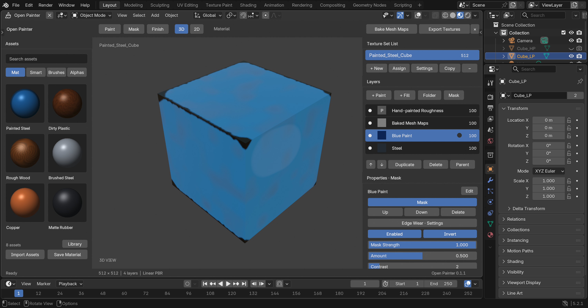

<!-- Active target: Blender add-on; native/ and prototypes/ are retained experiments. -->
# Blender Open Painter

A Blender extension for non-destructive PBR texturing: texture sets, paint and fill layers,
folders, masks, mesh-map baking, procedural generators, reusable smart materials, and texture export.
Python and Blender's bundled NumPy are the core runtime requirements. GPL-3.0-or-later.

**0.10.1 makes geometry effects follow the material:** rust flakes where the aging shows
corrosion, paint chips along the edge of the coating loss, moss where growth is, bolts on painted
spots — coloured by the surface under them, optionally your own meshes, regenerating as the age
changes. [Details](docs/geometry-effects.md#placement-from-the-material-0101).

**0.10.0 adds material aging:** say what a thing is (carbon steel under epoxy primer and
polyurethane paint, oak, copper, ABS…), where it lived (a coastal decade, then a shed), how it was
used and kept, and how old it is; a material-specific simulation predicts fade, gloss loss,
cracking, coating loss, rust, patina, greying, dirt… and drives a nondestructive aging folder
placed by the mesh. Age is a keyframable parameter. [Details](docs/material-aging.md).

**0.9.7 adds decal objects:** a decal is a Blender Empty — move, rotate, scale or duplicate it in
the viewport and the layer's Base Color, Roughness, Metallic, Normal, Height and Emission follow,
non-destructively. [Details](docs/decal-objects.md).

**0.9.5 adds physical scale:** author scratch widths, rust spot sizes and blur radii in
millimetres; Open Painter measures the mesh and resolves them per asset, so a material looks the
same on a mug and a truck. [Details](docs/physical-scale.md).

**0.9.4 makes filters seamless:** blur, dilation, warps and directional effects run in *Surface*
space by default — they follow the mesh across UV seams and take world directions.
[Details](docs/surface-filters.md).

**0.9.3 reworks masks:** every entry is a source with its own blend, strength and levels — painted
data, strokes, fills, generators, mesh masks — and **Mask Groups** nest so masks feed masks
(Curvature × Noise → Levels → group → stack); **Custom Graph** masks run your own shader node group.
[Details](docs/mask-architecture.md).

**0.9.2 adds mesh masks:** a mask can be a Blender object, collection, material, vertex group,
face set, face selection, UV island, normal direction or geometry attribute — exact through the UVs
and live: add a screw to the *Screws* collection and the rust follows. [Details](docs/mesh-masks.md).

**0.9.1 adds Bake Doctor:** a *Bake Check* runs before every bake (UVs, normals, scale, naming,
duplicate vertices, modifiers, cage intersections, seams) and clicking a finding selects the
offending geometry in Blender; the *Bake Correction Brush* paints projection distance, skew,
direction, high-poly and AO exclusions per region and rebakes the painted area when the stroke
ends. [Details](docs/bake-doctor.md).

**0.9.0 adds layer performance tools:** *Profile Layers* shows what each layer costs the preview,
a row toggle bypasses a layer in the preview only, layers and isolated folders can be **Cached** or
**Frozen** as persisted images, and **Freeze While Painting** defers expensive recomputation until a
brush stroke ends. [Details](docs/layer-performance.md).

**0.8.0 adds Material Director:** describe a material or a refinement and Codex proposes
ordinary editable layers, masks, scene fields and filters. Native Codex image generation supplies
surface textures and grayscale masks, packed into the `.blend`. Open the **Assistant** sidebar tab
inside Open Painter. Create and Refine apply validated changes; Plan leaves a draft to review;
Explain discusses the current material. Protected content, Show Changes, one-step Blender undo,
and conflict-aware **Undo Last AI Change** keep edits reviewable. **Scene Materials** coordinates
existing material regions in one operation. Model views and mesh-map previews are enabled by default;
an optional reference image guides generation. This feature requires a separately installed, supported Codex runtime and account.
See [setup, controls and current limits](docs/material-director.md).

Version **0.2.9** evaluates editable layers and masks through an internal Blender
material shader graph. Supported sliders update shader values immediately;
texture baking is reserved for export, explicit snapshots and isolated operations
that need pixels. Existing `LIVE` projects adopt this path without reapplying presets.
See the [architecture and diagnostics](docs/shader-preview-architecture.md).
The supplied 2048 project's authoring, save/reopen/export, and held Cavity Dirt
slider checks have passed. The visual check used an isolated native RNA sidebar;
it does not cover navigation through the product panels. See the linked report
for capture timing and remaining limits.

All 50 smart materials retain the generated wear masks and raised relief added in
0.2.6. See the [material review](docs/material-surface-review.html) and
[source/validation record](docs/material-surface-quality.md).

Exported Normal already includes Height. Use the separate Height map for
displacement, or omit it when using the combined normal; applying it through a
second bump node repeats the same relief.

**Feature target:** the supplied Substance Painter documentation dated June 26, 2018.
Full parity is not achieved. The [page-referenced feature inventory](PARITY.md) records working
subsets, missing workflows, external dependencies and acceptance criteria.

## Install

Tested on **Blender 5.2.1 LTS, macOS Apple Silicon**. The manifest requires Blender 5.2 or newer;
other platforms and newer versions have not been tested.

1. Download `open_painter-0.12.2.zip` from the
   [latest GitHub Release](https://github.com/caspianmoon/open_painter/releases/latest), or build it
   with `python3 scripts/build_extension.py` (it lands in `dist/`).
2. In Blender, open **Edit → Preferences → Add-ons**, open the menu at the top right,
   choose **Install from Disk**, and select the ZIP. Enable **Open Painter** if needed.
3. Click the **Editor Type** selector at the upper-left corner of any Blender editor—the menu
   containing 3D Viewport, Image Editor, Shader Editor, and the other editors.
4. Choose **Open Painter**. It opens in that same area with Assets along the bottom, the paint viewport
   in the center, and Texture Set, Layers, Inspector and Assets on the right. It does not create a workspace
   or rearrange your screen. Use Blender's usual **Ctrl+Space** to maximize the area if desired.
5. Use Blender’s Editor Type selector to switch to another editor.

The entry is a supported Python editor subtype adapter. Blender registers it through its NodeTree
subtype API; when selected, it mounts the native 3D/Image Editor painting backend in that area.
It is not a new compiled Blender SpaceType. The native editor selector remains available, and the
backend's selector highlight can read 3D Viewport or Image Editor while Open Painter is active.

The ZIP follows Blender's [extension packaging format](https://docs.blender.org/manual/en/latest/advanced/extensions/getting_started.html).
Core texturing works offline without an account or separate Python installation.
Material Director is optional and connects through the user's Codex installation.

## Texture library

Version 0.2.0 adds all **50 requested smart materials**, **16 stackable effects**, **18 smart masks**,
**65 procedural sources** and **52 texture filters**. They form editable layer and mask recipes.
See the [v1 workflow and controls](docs/texture-workflow-v1.md) and the [material catalog with required maps](docs/material-catalog.md).

The native Painter tool header has an **Assets** menu (import, save, refresh) beside a type filter — **Materials, Smart Materials, Smart Masks, Filters, Brushes, Alphas, Textures, Geometry Effects** — for the bottom shelf; **All Types** clears it. The shelf's own catalog tabs offer the same categories once enabled in its ☰ menu. See [asset category controls](docs/asset-categories.md) for activation and import behavior.

## First use

1. Select your low-poly mesh. It needs a UV map in the 0–1 tile. A new texture set immediately creates and assigns a Principled material with all eight initialized texture images connected.
2. Click **+** in the **Texture Set** panel. A selected UV-unwrapped mesh is assigned automatically; the panel
   names the assigned objects, and **Texture Set Settings › Assign Selected** links additional meshes. For a mesh
   with multiple materials, choose the intended active material slot before assigning. Repeat for additional objects/slots.
3. Use the resolution dropdown in the Texture Set panel to choose resolution (default 2048).
4. Click **Bake Mesh Maps** in the tool header to open the **Bake** tab (Setup, Maps, Results). Under Setup, select
   high-poly objects and click **Add Selected**, then set the ray distance. Maps shows every map's real state
   (Missing, Up to Date, Out of Date, Baking, Failed or Not Checked); **Select** picks the maps the material reads,
   **Bake Selected Maps** bakes them. For self-bakes, disable **Bake from High Poly**. Previous maps stay until a
   replacement lands, and **Stop After This Map** ends the queue honestly.
5. Use **Add Layer** (Paint, Fill, Folder, Decal, Smart Material, Module), **Add Mask**, **Add Effect** and **More**
   above the layer list. Select layer content by clicking its name; the mask icon beside it selects its mask stack.
6. Click **Add Baked Normal and AO Layer** under Bake › Results to add those mesh maps to the material.
7. Select a Paint layer, choose its paint destination in the **Inspector**, then click **Paint**.
   Use Blender’s brush selector and native brush settings. The composite refreshes after the stroke ends.
   Selecting a fill, folder or non-painted mask ends the session; **Finish** also ends painting.
8. Click a material thumbnail in the bottom native Asset Shelf to select it: the **Assets** panel names it,
   lists what it needs and the exact target, and its **Apply** button (also in the tool header) applies it.
   Clicking the same thumbnail again applies too. The type filter beside the **Assets** menu in the tool header narrows the shelf
   (**Materials**, **Smart Materials**, **Smart Masks**, **Filters**, **Brushes**, **Alphas**, **Textures**,
   **Geometry Effects**); search and thumbnail size use Blender’s shelf controls. The panel's **Library** sub-panel
   holds portable smart-material import, save and library commands.
9. Click **Export** in the tool header to open the **Export** tab: choose Contents, Scope, a destination preset
   and folder, read the Output Preview, then export.

Layers are displayed top-first and evaluated bottom-first. Press a row to select its content and
drag it up or down to move the layer (a folder moves with its contents); move the mouse sideways
while dragging to change how deeply the layer nests, and press Esc to put it back. The arrow
buttons under the list move one step at a time, and the Parent button moves the selected layer into
a chosen folder. Each row shows the blend mode and opacity of the channel selected above the list;
double-click a name to rename it. Delete removes a folder and its descendants. Undo restores them.
Folder duplication copies children and their paint images. The native panel uses single selection.

**T** toggles Blender’s native left toolbar. **N** toggles the right sidebar containing Painter’s
Texture Set, Layers, Inspector and Assets panels, and the Bake and Export tabs. These are Blender’s standard
shortcuts, with no custom modal interception. **More › Open Inspector** shows the full inspector in a Properties
area beside the viewport. Toggle **Asset Shelf** through Blender’s View menu. Resize the sidebar and shelf
using their native borders. No surrounding editor areas are rearranged.

The mask menu offers white/black painted masks, projected fill masks, generators, baked maps and
anchor points; anchors in mask or filter stacks feed Published Input masks, fill channel content and
generator micro details ([anchor points](docs/anchor-points.md)).
Select **Assets → Smart Masks**, select the target layer, select a preset and click **Apply**. Application
adds an editable effect on top of the existing masks; **Replace Masks with This** in the asset's right-click
menu (and the Assets panel) is the separate, visible replacement. Required mesh maps are checked before
modifying the stack. The 18 bundled presets include edge, cavity, dust, rust, scratch and drip masks.

A mask on a **folder affects every child**, including the metal substrate in Painted Steel. For
chipped paint over metal, select **Paint coat** before applying a smart mask. The Inspector identifies
the target and exposes generator, invert, levels, strength and **Normal / Multiply / Add** combination.
New smart-mask effects use Normal; saved effects keep their previous combination.
Edge Wear uses baked geometric crease coverage; noise only breaks up that coverage. After upgrading from an older bake, click **Rebake Edge Map** in Edge Wear properties. **Minimum Edge Angle** determines which convex target-mesh creases qualify; **Edge Width (px)** determines their texture width. Re-bake after changing either; generator intensity does not change edge classification. **Bake Mask Stack to Texture** converts the selected layer’s mask effects into one packed, editable grayscale UV texture. The material node graph only displays channel textures; it does not implement edge-wear or grunge effects. This is an editable
mask-effect workflow, not complete Substance Painter generator parity.

The Inspector shows the selected item's own controls first — a smart material's master controls (every built-in material has 4–8 authored ones, see [master controls](docs/master-controls.md)), a fill's channel content with native color/image and UV/triplanar transform controls, a paint layer's destination, a mask's settings — and publishing, module, cache and profiling controls after them. Layers has its own scrollable list; opacity is displayed as a percentage. The modeling toolbar starts hidden outside painting. The selected layer's blend and
opacity for the display channel sit in the row above the list (every row shows them with the **Blend and Opacity in Layer Rows** preference), independently of the paint destination. **Use Layer Blend**
keeps the layer-wide setting. Blender draws the controls, handles numeric editing and scrolling,
and applies its current theme and interface scale.

Brush Properties exposes color or scalar value, size, strength, spacing, erase and alpha controls.
Scroll the Inspector to reach all controls. **Import Alpha** loads a grayscale image and packs
it into the blend. Alpha thumbnails show the imported image; **Clear Alpha** removes the brush mask.
Bundled brushes are copied to local brush assets so imported textures work and persist without
modifying Blender's bundled library. For painted masks, **Black · Hide** and **White · Reveal**
set the brush value directly.

The Inspector's mask section provides mask selection/reorder/delete, enable/invert, strength, levels,
and generator controls, with the selected mask's settings in their own sub-panel; **View Mask** shows the
mask alone in the viewport and **Back to Material** returns. **Texture Set Settings** exposes renaming,
evaluation, assignment, repair and validation. **Assets › Library** holds smart-material
apply/import/save/delete actions.

3D painting uses a temporary face-selection mask to protect material slots outside the current
texture set. The previous face selection and mask setting are restored when painting ends, including
after save/reload. 2D painting edits the selected layer image directly; finishing changes the 2D editor
to view mode so it cannot paint into the evaluated output. Export and save flush pending paint changes.

## Included example

Open [`examples/open_painter_demo.blend`](examples/open_painter_demo.blend) after enabling the extension.
It contains explicit HP/LP assignments, baked maps, Painted Steel layers and an actual viewport-painted
roughness image. A portable smart material and example Unreal textures are in `examples/`.
The high-poly source is hidden in the demo; baking temporarily makes it available and restores visibility.

Alongside the 50 new smart materials, the Assets shelf retains **Painted Steel, Dirty Plastic, Rough Wood, Brushed Steel, Copper,
Matte Rubber, Porcelain and Red Paint**. These original PBR presets contain coordinated color,
roughness and subtle height textures. Painted Steel and Dirty Plastic create editable groups.
They work without a bake; they do not reproduce mesh-aware edge wear or physical dust deposition.
Shelf thumbnails are Cycles renders of the actual presets, not illustrative swatches.

Older bundled portable smart-material files still demonstrate bake-driven generators; those
require their indicated mesh maps. Existing projects keep their authored layers when upgraded.

## Export conventions

| Preset | Files / encoding |
| --- | --- |
| Blender | BaseColor, Roughness, Metallic, Normal, Height, AO, Emission, Opacity |
| Unreal Engine 5 | BaseColor, DirectX Normal (green inverted), ORM: R=AO, G=Roughness, B=Metallic |
| Unity Standard Metallic | BaseColor, OpenGL Normal, MetallicSmoothness: R=Metallic, G=B=0, A=1−Roughness; separate Occlusion |
| Custom | One RGBA image; assign scalar channels, smoothness, zero or one independently |

BaseColor and Emission are encoded as sRGB; other maps contain linear data. PNG/TIFF support 8 or 16 bits.
Export resolution overrides resample the evaluated textures. Files use
`{prefix}{texture_set}_{channel}{suffix}.{ext}` with filesystem-safe names. Existing files are
never overwritten; choose a new folder, prefix or suffix. In Unreal/Unity import packed maps as
linear data and normal maps using the corresponding engine's normal-map import setting.

## Persistence and safety

Project state lives in the scene. Managed images are packed on save, so the `.blend` is portable
and its material preview remains available with the extension disabled. Original materials and
unrelated user nodes are retained. Removing a texture set restores its assigned slots where possible;
it does not delete images, materials, meshes, or unrelated nodes. Texture-set copies are unassigned
until you explicitly assign new mesh slots. Use Blender's orphan cleanup when you want to reclaim
unused managed datablocks. Undo covers project edits; exported and library files are filesystem operations.

## Current limitations

- Shader Native is the default authoring mode. Supported numeric edits update existing bindings; legacy procedural fields and spatial filters can require isolated raster inputs. Initial graph construction and Blender's material redraw still have a cost. Native save preserves source images without baking output channels; export and explicit CPU Reference evaluate textures. See the [measured scope and remaining costs](docs/shader-preview-architecture.md); no universal viewport frame-time target is established.
- Painting is one channel at a time. The native brush engine writes the layer image, which the material shader samples. A native 2D composite is an explicit snapshot and requires an explicit refresh after edits. Finishing native painting keeps the authored source canvas visible. Idle Open Painter sessions do not repeatedly hash the canvas. **Refresh** is available for externally changed textures.
- Normal channels offer RNM, whiteout, additive and replacement blending. Select the intended normal blend mode explicitly; existing projects retain their saved mode.
- Curvature is a convex-crease map of the evaluated target mesh, filtered by Minimum Edge Angle. Smooth continuous curvature and high-poly-only normal detail are not transferred.
  Dust uses baked world-normal Z; moving or deforming geometry requires rebaking affected mesh maps. UDIM authoring remains unsupported.
- Triplanar uses the base mesh's world positions and interpolated vertex normals through the render UV layer. Apply topology-changing modifiers first; after moving geometry, use Refresh. UVs outside the first tile and overlapping islands
  are not a supported authoring workflow.
- Automatic cages use a manual distance. Custom cage support is limited to one low-poly mesh with matching topology.
  Baking is synchronous and uses Cycles CPU for predictable behavior.
- Shared mesh datablocks require an explicit single-user copy. Material slot insertion/reordering after
  assignment can invalidate references; use Validate Project and reassign the affected slots.
- Painter uses native Blender panels, properties, menus and an Asset Shelf, arranged around the native viewport. Asset activation is click-based. Layers reorder by dragging their rows; multi-selection is not implemented in this native interface. The original N-panel remains available outside Painter.
- Anchor points reference within one texture set and ignore projection and UV transforms; folder channels cannot be anchored. A missing anchor evaluates as neutral and is reported, not repaired.
- Smart-material import is limited to 512 MiB and 256 layers. External paint textures are bundled as EXR;
  missing generator maps must be baked in the destination texture set.

## Development

```sh
python3 scripts/build_extension.py
python3 scripts/run_tests.py --blender /path/to/blender
python3 scripts/run_tests.py --blender /path/to/blender --gui
python3 scripts/run_tests.py --blender /path/to/blender --gpu-only
```

See [ARCHITECTURE.md](ARCHITECTURE.md), [CONTRIBUTING.md](CONTRIBUTING.md),
[SMART_MATERIAL_FORMAT.md](SMART_MATERIAL_FORMAT.md), and [TESTING.md](TESTING.md).

## Screenshots




See [CHANGELOG.md](CHANGELOG.md) for changes in 0.2.0.


## 0.1.9: bottom shelf, painting memory, and materials

The reference layout now places a compact tool strip on the left, contextual brush controls above the viewport, assets across the bottom, and texture sets/layers/properties on the right. Controls continue reading Blender's current theme and font settings. That custom overlay was replaced by native regions in 0.1.13; T now toggles the native toolbar.

The library bundles CC0 Poly Haven maps for Rough Wood, Fine Wood, and Weathered Paint. Base color uses sRGB; roughness and OpenGL normal maps use Non-Color. Applied maps are packed into the project. The other original presets have regenerated material previews; Copper and Dirty Plastic were adjusted. No material downloads occur during use. See [research and sources](docs/research/improvements-0.1.9.md).

Paint detection reuses raster buffers and bounds temporary comparison storage. Rectangle and tool geometry are cached between UI redraws. These changes reduce allocations; they do not eliminate Python's full image upload cost or establish a guaranteed painting frame rate.
