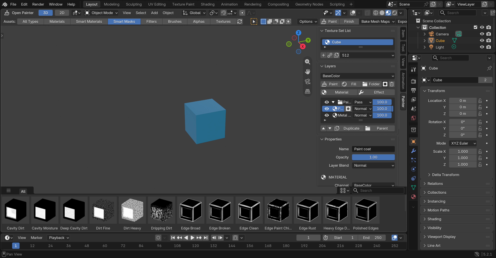

# Open Painter

Non-destructive PBR texturing inside Blender: texture sets, paint and fill layers, folders,
masks, mesh-map baking, procedural generators, smart materials and texture export.

Open Painter is free software under the [GNU General Public License, version 3 or later](LICENSE).
It runs inside Blender 5.2 and later, on macOS, Windows and Linux.



## What it does

- **Texture sets and layers.** Paint, fill and folder layers with blend modes, per-channel
  opacity and eight PBR channels: Base Color, Roughness, Metallic, Normal, Height, AO,
  Emission and Opacity.
- **Masks.** Painted masks, generators, baked mesh maps, mesh masks (objects, collections,
  vertex groups, face sets, UV islands, attributes), nested [mask groups](docs/mask-architecture.md)
  and editable [Mask Graphs](docs/mask-graphs.md).
- **Smart materials.** 50 built-in smart materials with [master controls](docs/master-controls.md),
  18 smart masks, procedural sources and filters. Save your own as portable
  [`.openpaintmaterial` files](SMART_MATERIAL_FORMAT.md).
- **Baking.** Normal, AO, curvature, position, thickness and other mesh maps from high-poly
  sources, with a pre-bake check and a correction brush ([Bake Doctor](docs/bake-doctor.md)).
- **Painting.** Paint Material strokes across all enabled channels, symmetry, smudge, text
  masks, Brush Graphs and particle painting ([authoring tools](docs/gpu-authoring-tools.md)).
- **Open Graph.** A node view of the stack with templates ([Open Graph](docs/open-graph.md)).
- **More.** [UDIM sets](docs/udim-workflow.md), [material aging](docs/material-aging.md),
  [geometry effects](docs/geometry-effects.md), [decal objects](docs/decal-objects.md),
  [physical scale](docs/physical-scale.md) and [anchor points](docs/anchor-points.md).
- **Export.** Blender, Unreal Engine 5, Unity and custom channel packing, with UV padding,
  as 8- or 16-bit PNG or TIFF.

Layers are evaluated by the [Open Painter engine](docs/open-painter-engine.md). Each layer
channel and mask compiles to a small GPU program, and edits re-render only what they
reach. A portable C17 library ([libopenpainter](libopenpainter/README.md)) schedules that
work on Metal, Vulkan and OpenGL. It also runs the CPU kernels for export, baking support
and painting, with exact SSE4.2 and NEON paths. Without the library, Open Painter falls
back to its Python implementation with the same results.

## Install

1. Download the zip for your platform from the
   [latest release](https://github.com/caspianmoon/open_painter/releases/latest). Each
   platform zip bundles the native library. A zip without a platform in its name runs
   anywhere on the Python implementation.
2. In Blender 5.2 or later, open **Edit › Preferences › Add-ons**. Open the menu at the top
   right, choose **Install from Disk**, and select the zip.
3. In any editor, open the **Editor Type** menu at its top left and choose **Open Painter**.
   It opens in that area, with the assets along the bottom and the Texture Set, Layers,
   Inspector and Assets panels on the right. Your screen layout is left alone.

Start with the [user guide](docs/user-guide.md) and the [texture workflow](docs/texture-workflow-v1.md), or open
[`examples/open_painter_demo.blend`](examples/open_painter_demo.blend) after enabling the
add-on.

## Privacy and network use

Open Painter works offline, needs no account and collects no telemetry. One optional
feature uses the network:

- **Material Director** (the Assistant tab) turns a description into editable layers and
  masks using OpenAI's Codex with your own ChatGPT account. It does nothing until you
  click **Connect**, and only while Blender's **Allow Online Access** is on. On first
  connect it downloads the OpenAI Codex CLI from the npm registry (a pinned version,
  checked against its SHA-512) and runs it on your computer. Sharing material context
  with it is a separate option. See [Material Director](docs/material-director.md).

The optional **Open Painter Connect** extension adds sign-in, the Materials+ library and
team sharing from [openpainter.dev](https://openpainter.dev). It is a separate download.

## Open Painter Studio

Open Painter Studio, a free standalone app built on the same material model, is available
for Mac with Apple silicon (macOS 13 or later) from
[openpainter.dev/download](https://openpainter.dev/download); a Windows version is coming
soon. It is a separate product from this extension.

## Build from source

You need CMake 3.16+, a C17 compiler and Python 3.11 or later. The compiled binding also
needs CPython 3.11+ headers.

```sh
python3 scripts/build_native.py --python-include /path/to/python3.x/include \
    --package dist/open_painter-native.zip    # library, binding, C tests and a platform zip
python3 scripts/build_extension.py             # a zip without the native library
```

Run the Blender test suites with `scripts/run_tests.py`; see [TESTING.md](TESTING.md). How
the pieces fit is in [ARCHITECTURE.md](ARCHITECTURE.md), and platform notes are in
[docs/native/platforms.md](docs/native/platforms.md).

## Contributing

Bug reports and pull requests are welcome; see [CONTRIBUTING.md](CONTRIBUTING.md).
Contributions are accepted under the GPL-3.0-or-later. Third-party code and assets are
credited in [NOTICE.md](NOTICE.md). Changes are listed in [CHANGELOG.md](CHANGELOG.md).

## License

Copyright © 2026 Open Painter contributors. Open Painter is free software: you can
redistribute it and/or modify it under the terms of the GNU General Public License as
published by the Free Software Foundation, either version 3 of the License, or (at your
option) any later version. It is distributed in the hope that it will be useful, but
without any warranty; see [LICENSE](LICENSE).
