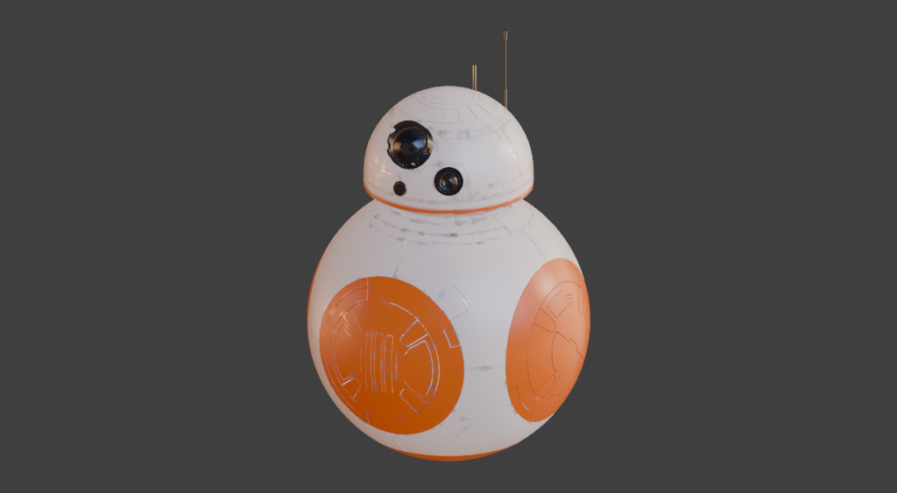

# Material Director: native images and full-scene acceptance

## Result

Tested the actual ten-part model from **`open painter test.blend`** with the user's Codex account,
using exactly this instruction:

> Texture this like a Star Wars robot.

The integration inspected and authored all ten material regions in one coordinated operation.
Codex generated two real image textures and chose ivory bodywork, orange panels, dark optics and
metallic antennas. The result renders and remains editable. **The broad design works; detailed panel
art is unfinished.** Solid orange discs need secondary color separation, and some wear still reads
as thin outlines. Passing the workflow checks does not make this a finished production asset.

[Rear view](validation/material-director-starwars-rear.png) ·
[Side view](validation/material-director-starwars-side.png) ·
[Machine-readable evidence](validation/material-director-full-scene.json)

## Clean input and actual account

- Source: the user's full droid model, including the head, optical assembly, antennas, body shell and
  six panel regions. No substitute demo model was used for this acceptance run.
- Removed the previous six authored layers, eleven old map records and old material assignments
  in a disposable copy. Created ten empty 1024-pixel texture sets and baked new maps from geometry.
- Every region had current AO, curvature (including multiple widths), normal, world normal,
  position and thickness maps. Bake setup used 32 samples with selected-to-active disabled.
- Verified the original source file's SHA-256 before and after; it was never overwritten.
- Runtime: `codex-cli 0.154.0-alpha.6.2`; actual account-default model: `gpt-6-astra`.
- The opt-in launcher used temporary access-only authentication from the current Codex login.
  It did not copy or rotate the shared refresh token. No separate image API key was used.

The final art-direction run sent **no appearance reference**. It received the whole-model screenshot,
scene inventory, and each part's framed isolated view plus its six labeled mesh-map previews. The
model called `get_material_context` for all ten unique targets before proposing changes. The earlier
olive-reference test was an over-specified art direction; it is retained only as separate reference
and grouped-workflow evidence, not as the requested result.

## Live results

| Actual instruction/workflow | Result |
| --- | --- |
| “Texture this like a Star Wars robot.” | Applied across all ten regions in **193.40 s**, including two native image generations. |
| “Look at the full model. Does it look like a Star Wars robot? What would you improve?” | Responded in **15.57 s**, without document mutation or Blender image allocation. Correctly identified overly uniform orange panels, traced wear and optical segmentation limits. |
| Render verification | All ten material previews ready; front, rear and side views captured. No pink shader-failure pixels in the measured main views. |
| Reopen without Codex | Both source images remained packed, readable and hash-identical. |
| Undo creation after reopening | One AI undo restored **all ten** pre-instruction material stacks. |
| Earlier full-scene Plan → Apply → Undo | Draft in **78.32 s**; no premature material/image changes; exact grouped restoration after applying the eight-material refinement. |

Creation used 190 constrained authoring commands in one scene proposal. The model authored normal
fill layers, geometry-aware masks and editable channels, including an orange dome band placed with
world-height masks. It used the same generated enamel sources across appropriate parts. It did not
generate a robot photograph and project it onto the mesh.

### Native generated sources

| Source | Actual output | Use |
| --- | --- | --- |
| Warm ivory enamel | 1254 × 1254 PNG, packed sRGB | Body, head and an ivory panel region |
| Muted orange enamel | 1254 × 1254 PNG, packed sRGB | Service panels and head identification band |

The evidence JSON records complete image IDs, pixel/hash verification, assignments and edge
difference diagnostics. The host imported the actual app-server `imageGeneration` results. Native
grayscale detail generation, Non-Color import and Plan-before-import behavior were also exercised
in the preceding account tests. Albedo is not automatically treated as a normal or roughness map.

## What this test exposed

The previous single-material adapter could not execute a full-scene instruction. Scene scope now
provides a compact inventory, image-bearing per-material inspection tools, a complete scene proposal,
atomic commit/rollback and persisted grouped undo. Scene Create rejects a proposal that omits a
captured material or skips its inspection.

The system prompt now explicitly follows the artist's art direction. Industrial-steel examples are
not defaults. The short Star Wars instruction was sent verbatim, without a hidden olive-paint recipe.
The [shipped prompt](../src/open_painter/authoring/material_director_prompt.md) covers visual evidence,
map interpretation, native image generation, physical channels, scene coordination and tool limits.

Other fixes verified during image/reference work include preserving packed originals during image
import, refreshing reused shader bindings after mixed structural/numeric changes, and normalizing
undo receipts before resolving retired derived-analysis images.

## Remaining limits

- Existing material assignments define the editable regions. This test does not establish automatic
  segmentation of an arbitrary imported asset. Scene scope currently supports up to 16 managed sets.
- The optical mesh combines lenses and housings; it received one dominant glossy dielectric finish.
  The API does not expose transmission/IOR, so the lenses are an opaque approximation.
- Orange panels need more detailed internal color separation. Native image generation alone did not
  solve semantic selection of their inset details. More dirt would not fix that design problem.
- Mesh bakes were explicitly prepared with the Blender test script. Codex does not launch baking or
  change geometry/UVs through this API.
- View screenshots reflect the current studio lighting. The paler side panel is affected by lighting;
  the result should also be reviewed under neutral light.
- Generated textures are not guaranteed seamless, calibrated or a matched PBR channel set.
- Create applies after the Codex turn. Visual critique is a following instruction, not an autonomous
  render/refine loop inside the same turn.

## Saved workspace artifacts

- Clean baseline: `.blender-test/director-user-model/fresh-full-scene.blend`
- Final result: `.blender-test/director-starwars-scene/01-scene_starwars.blend`
- Full run: `.blender-test/director-starwars-scene/report.json`
- Offline check: `.blender-test/director-starwars-scene/offline-images.json`
- Earlier grouped Plan acceptance: `.blender-test/director-full-scene/report.json`

The large `.blend` files are local workspace artifacts and are not bundled into the extension ZIP.
Reproduction commands are in [TESTING.md](../TESTING.md#supplied-full-model-acceptance).

Supporting checks: **78 pure tests**, **23 Blender Material Director integration tests**, native
Director UI/Blender undo/redo, and shader reuse/structural/undo checks passed. Real-account use cases
and visual inspection above are the acceptance evidence; these checks supplement them.
