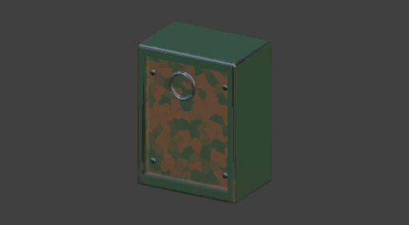
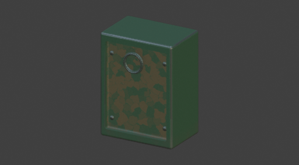
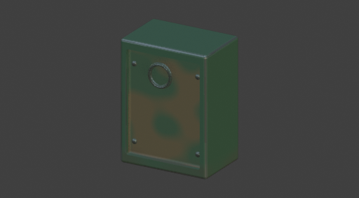

# Material Director: real Codex acceptance

**2026-09-15 — the editable authoring workflow works after fixes. First-pass realism remains weak.**

This used the user's signed-in Codex, real model responses, the actual companion and tool API,
native Blender operators, material evaluation, viewport captures, and saved editable `.blend` files.
The model's proposals were not fixtures. A successful tool call alone was not counted as visual success.

Environment: Blender 5.2.1 LTS, macOS Apple Silicon, `codex-cli 0.154.0-alpha.6.2`.
The UI used **Account default**; the runtime advertised `gpt-6-astra` as its default.
The disposable industrial housing had UVs, an actual recessed panel, screws, and a handle.
The test supplied named **Handling** and **Recessed Screws** vertex groups; it did not test automatic part recognition.

## Actual use cases

| Instruction | Result | Evidence |
| --- | --- | --- |
| Old Soviet industrial steel: green paint, edge chips, scratches, cavity rust, bottom dirt, oily fingerprints | **Partial** | Codex created six normal editable layers in 65.82 s. The result looked camouflage-like; the fingerprint layer initially retained color and metallic channels. |
| Too much rust; reduce it by half without changing paint or scratches | **Pass after fixing control guidance** | 11.49 s. Rust opacity `0.48 → 0.24`. Its effective mask was exactly halved at every sampled point; other masks were unchanged. |
| Make the bottom dirtier, keep recessed screws clean | **Needed a follow-up** | 18.35 s. Dirt opacity `0.68 → 0.90`, plus an inverted screw-group exclusion. Bottom dirt increased, but tiny UV-island edges still leaked dirt. |
| Why does this look procedural? Send the current view | **Useful but imperfect** | 21.61 s on the final rerun. Explain read the real view and named real controls without changing the material. Its suggested refinement did not remove the camouflage-like appearance. |
| Fix those two problems; preserve the protected paint color | **Pass as an editable refinement after fixes** | 22.00 s. Previous diagnosis reached the next turn. Codex changed nine controls, including edge distance `0.025 → 0.012`; scene analysis updated and the material rendered. |
| Plan a stylized PS2 treatment, then Apply and Undo | **Pass** | 35.10 s. No mutation before Apply. The applied result used broader shapes and fewer fine details. AI Undo restored the preceding material document exactly. |
| Make existing fingerprints affect roughness only where held | **Pass** | 21.91 s. Only the fingerprint layer's Base Color and Metallic were disabled. Roughness and the existing handling mask remained; sampled influence outside Handling was zero. |
| Dirt still leaks onto screw edges; clean it without reducing housing dirt | **Pass on the sampled regions** | 14.44 s. Codex changed the existing exclusion's white level `1 → 0.01`. Sampled dirt on screws became zero. |

Times measure the model/authoring turn; additional scene-analysis and capture time is excluded.
This table combines completed cases from successive runs, including reruns after failures. It is not
a claim that the first full run passed or that future model replies will be identical.

## Actual images

**Created material:** editable but visually too uniform and patchy.



**After conversational refinements and explicit region corrections:** valid rendering, still an
unfinished material. The remaining camouflage-like patching is visible.



**Applied PS2-style draft:** broader patches, simpler roughness and reduced fine scratches.



## Failures found and changes made

- **Lost conversation:** each ephemeral Codex turn received material receipts but not earlier replies.
  Added the last six instruction/reply pairs for the current material, with explicit applied/draft/discarded
  outcomes. The conversation stays in memory and clears on disconnect, file load, undo, or Clear AI History.
- **Wrong rust control:** reducing Multiply-mask strength weakens an exclusion and can increase coverage.
  Documented the real mask equations and layer-opacity alternative in the model instructions.
  The real rerun chose opacity; numerical evaluation confirmed the requested direction and factor.
- **Broken spatial fields:** scalar attribute interpolation accidentally broadcast into a quadratic array.
  Fixed the missing component axis. Separate unpublished fields now have separate cache identities,
  and changes to field parameters invalidate their source so analysis actually reruns.
- **Pink Metal rendering:** one valid proposal produced 14 Painter texture inputs plus viewport inputs;
  Blender reported 17 samplers and rendered pink despite successful host graph diagnostics.
  Added a conservative 12-input proposal budget, with feedback allowing the model to simplify its proposal.
  Existing larger materials can still receive edits that do not increase the estimate. This estimate is
  a guard against the observed failure, not a universal GPU rendering guarantee.
- **Premature view capture:** captures now wait for scene-field publication and report field errors.
  The live test also checks the actual PNG for Blender's pink error material, separately from graph status.
- **Default channel confusion:** clarified which channels a new fill layer enables. A real follow-up
  corrected the initially incorrect fingerprint layer using normal channel switches.

The final conversational and region reruns rendered with zero pink pixels in their captures.
Targeted Blender checks also passed: 17 Director cases, scalar/vertex-group scene masks, and shader undo.
These support the fixes; the live runs above are the use-case evidence.

## Measurements and artifacts

The numerical check evaluates actual generated masks on a **256 × 256 UV sample grid** with the real
mesh positions and vertex groups. It measures effective mask values, not percentages of world-space
surface area or every possible render sample.

- Rust mean influence: `0.0518951 → 0.0259476`; effective alpha halved at every sampled point.
- Initial bottom-dirt refinement: mean influence in the bottom region `0.163119 → 0.215182`.
- After the later screw-cleaning follow-up: mean screw dirt `0.0103518 → 0`, maximum `0.124902 → 0`.
  Mean influence across the bottom region stayed approximately `0.1194`.
- Corrected fingerprint layer: only Roughness enabled; maximum sampled influence outside Handling `0`.

[Prompts, replies, changes and timings](validation/material-director-live.json),
[rust/dirt measurements](validation/material-director-mask-values.json), and
[final region measurements](validation/material-director-region-values.json) are saved with this report.

Local workspace artifacts, intentionally excluded from the extension archive:

- Final editable material: `.blender-test/director-live-regions/02-clean_screws.blend`
- Applied PS2 draft: `.blender-test/director-live-verified/03-plan.blend`
- Original failure logs and full proposals: `.blender-test/director-live*/report.json` and corresponding logs.

## Reproduce

```sh
python3 scripts/test_director_live.py --use-codex-login
```

This consumes the current account's Codex allowance. It requires an existing ChatGPT login in the
standard Codex `auth.json` cache. The opt-in launcher copies only current access/identity tokens into
a private temporary cache, omits the shared refresh token, and deletes the temporary state on exit.
It uses a disposable Blender profile and scene. It never saves over the user's existing project.

To test follow-ups on a saved generated scene:

```sh
python3 scripts/test_director_live.py --use-codex-login \
  --blend .blender-test/director-live/03-bottom.blend \
  --cases explain,fix,plan --output .blender-test/director-followup
```

To measure saved results without further inference:

```sh
blender --background --factory-startup \
  --python tests/manual/analyze_director_live.py -- .blender-test/director-live
```

## Remaining limits

- This does **not** establish convincing realism from one description. The tested material still needs art direction.
- Viewport critique can identify controls yet make an incomplete visual diagnosis; inspect the resulting image.
- Browser sign-in, exhausted allowances, Windows/Linux, and large production-scene inference were not exercised.
  Reusing the user's current login for these tests is separate from the add-on's browser/keyring setup flow.
- Automatic assembly segmentation, material-slot assignment, water-flow reasoning and physical aging simulation
  remain outside the implemented tool API. Named test groups supplied the spatial regions here.
