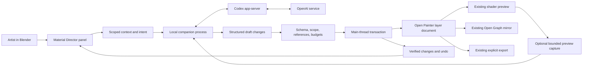

# Material Director: AI authoring for Open Painter

**Status:** Original implementation proposal. The first implementation is now in 0.8.0;
see [Material Director setup and implementation status](material-director.md) for delivered scope,
validation and remaining work. The repository review below records the original planning baseline.

**Reviewed:** 2026-09-15.  
**Repository baseline:** `41a16a8` (`Material -> Geometry: displacement, curves, detail prototypes, bake back`). `pyproject.toml` and `blender_manifest.toml` report **0.7.0**. The review began at `0b817c0` / 0.6.1 and incorporated the geometry work committed during the session. Version metadata does not establish release or test status; no Blender validation was run here.

## 1. Recommendation

Build **Material Director**, an optional native Blender panel that creates and revises ordinary Open Painter materials through a small, validated authoring API.

The first release should do three things well:

1. **Create:** describe a material for one existing texture set and receive an editable, sensibly organized stack.
2. **Refine:** change a selected material, layer, or mask without rebuilding the rest of the artist's work.
3. **Explain:** show the exact changes, their intended effect, and an immediate way to undo them.

Use the existing layer document as the source of truth. AI proposes a structured change set; Open Painter validates and executes it. The existing shader compiler, Open Graph mirror, scene-field engine, and exporter consume the result normally.

**The hardest work is reliable editing, scope, and recovery.** Material generation already has useful foundations in this repository. Prioritize a dependable edit transaction before a sophisticated chat interface or autonomous visual refinement.

Recommended integration: a local companion process using **Codex app-server over stdio**, with Codex-managed ChatGPT authentication. Gate that choice on a short compatibility and tool-isolation prototype. Keep the authoring protocol independent of Codex so a separately billed OpenAI API integration remains possible.

### Improvements to the original proposal

| Original idea | Improved implementation |
| --- | --- |
| A long list of low-level tools | A few model-facing tools that submit bounded change sets; a richer internal command registry executes them locally. |
| AI connects arbitrary nodes | AI edits layers, masks, effects, and typed anchor references. Open Graph and shader nodes remain derived. |
| AI constructs everything from scratch | Retrieve proven materials and effects, then make targeted edits; allow constrained novel recipes when needed. |
| “Texture this realistically” | Start with an explicit target and an editable material brief. Add part recognition after reliable single-set editing. |
| “Five years outdoors” | Translate the phrase into visible artistic controls and assumptions. Existing aging curves do not simulate physical years. |
| “Undo” | One verified material transaction per artist instruction, plus conflict-aware reversal when later manual edits exist. |
| AI-written “Show Changes” | Generate the diff from actual before/after authoring state. The model may explain it, but cannot invent what changed. |
| Unlimited inspect/render/refine loop | Bounded, opt-in refinement against consistent views and explicit visual goals. |
| “Use your existing account” | Use the documented Codex login flow, show actual account status and limits, and verify compatibility before promising availability. |

## 2. What the repository already provides

Source inspection takes precedence over historical roadmap and README claims. For example, README still describes 0.2.9, and parts of `ARCHITECTURE.md` describe older serialization versions.

| Capability | Evidence in the current source | Implication |
| --- | --- | --- |
| Declarative material entry point | [`api.py`](../src/open_painter/api.py), `apply_recipe` | Already accepts JSON-like recipes and rejects executable input at this boundary. Extend its architecture rather than inventing another material representation. |
| Catalog composition | [`smart_materials/composer.py`](../src/open_painter/smart_materials/composer.py): `apply_document`, `apply_effect`, `preflight` | Existing 50-material catalog, reusable effects, deterministic seeds, prerequisite checks, insertion rollback, and module stamping. Includes rust, dirt, scratches, grease, fingerprints, wetness, and streaks. |
| Stable authoring identities | [`properties/layer.py`](../src/open_painter/properties/layer.py), [`core/layer_stack.py`](../src/open_painter/core/layer_stack.py) | Layers and masks have IDs; folders, channels, duplication, placement, snapshots, and cycle-safe parenting already exist. Some filter IDs are assigned lazily. |
| Live shader authoring | [`evaluation/shader_preview.py`](../src/open_painter/evaluation/shader_preview.py), [`evaluation/shader_graph.py`](../src/open_painter/evaluation/shader_graph.py) | Numeric changes can update existing shader bindings. AI should preserve this path instead of forcing full texture evaluation after every command. |
| Branching through anchors | [`evaluation/anchors.py`](../src/open_painter/evaluation/anchors.py), [`evaluation/references.py`](../src/open_painter/evaluation/references.py), [`graph/edits.py`](../src/open_painter/graph/edits.py) | Shared mask/channel outputs, typed consumers, and cycle validation can keep paint loss, exposed metal, and rust spatially coherent. |
| Open Graph | [`graph/mirror.py`](../src/open_painter/graph/mirror.py), [Open Graph documentation](open-graph.md) | A projection of the texture set. `connect` translates graph links into authoring fields; shader nodes are not a supported editing API. |
| Geometry-aware masks | [`properties/influencer.py`](../src/open_painter/properties/influencer.py), [`generators/scene_fields.py`](../src/open_painter/generators/scene_fields.py), [`evaluation/field_jobs.py`](../src/open_painter/evaluation/field_jobs.py) | Up/down orientation, height, ground distance, proximity, exposure, convexity, concavity, edges, attributes, and vertex groups already exist. Analysis is bounded and can run cooperatively. |
| Scene-mask recipes | [`ui/scene_fields.py`](../src/open_painter/ui/scene_fields.py) | Crevice dirt, radial rust, ground mud, and live edges have preset definitions. Extract reusable service functions; verify each recipe visually before relying on its label. |
| Mesh and UV inspection | [`geometry/snapshots.py`](../src/open_painter/geometry/snapshots.py), [`geometry/texel_density.py`](../src/open_painter/geometry/texel_density.py), [`geometry/uv_overlap.py`](../src/open_painter/geometry/uv_overlap.py), [`analysis/analyzer.py`](../src/open_painter/analysis/analyzer.py) | Reuse evaluated geometry, area/density estimates, overlap checks, and resource inventory. These are not a semantic object-recognition system. |
| Baking and map provenance | [`baking/bake_manager.py`](../src/open_painter/baking/bake_manager.py), [`baking/jobs.py`](../src/open_painter/baking/jobs.py), [`geometry/provenance.py`](../src/open_painter/geometry/provenance.py) | Existing map work and staleness checks are reusable. The general queue cancels between maps; a running Cycles map still blocks. |
| Reusable modules | [`smart_materials/modules.py`](../src/open_painter/smart_materials/modules.py), [`core/material_inheritance.py`](../src/open_painter/core/material_inheritance.py) | Versioned folder subtrees and three-way merges already preserve local edits. Reuse that approach for AI/manual-edit conflicts. |
| Artistic aging | [`core/material_states.py`](../src/open_painter/core/material_states.py), [`core/environment_profiles.py`](../src/open_painter/core/environment_profiles.py) | Age, usage, maintenance, and environment influence explicitly tagged effect-layer opacities. Local override protection exists, but does not cover arbitrary mask/channel parameters. |
| Material-driven geometry | [`geometry_effects/manager.py`](../src/open_painter/geometry_effects/manager.py), [`geometry_effects/displace.py`](../src/open_painter/geometry_effects/displace.py), [`baking/bake_back.py`](../src/open_painter/baking/bake_back.py), [geometry documentation](geometry-effects.md) | The 0.7.0 source includes owned geometry helpers, displacement, curve/detail workflows, and bake-back. Keep these outside the initial AI command scope; later adapters need their own geometry limits and recovery tests. |
| Persistence and export | [`smart_materials/format.py`](../src/open_painter/smart_materials/format.py), [`smart_materials/serializer.py`](../src/open_painter/smart_materials/serializer.py), [`export/exporter.py`](../src/open_painter/export/exporter.py) | Whole materials write format 3; modules write format 4. Reuse serialization/export and maintain backward compatibility. |
| Native UI and lifecycle | [`ui/native.py`](../src/open_painter/ui/native.py), [`registration.py`](../src/open_painter/registration.py), [`evaluation/cache.py`](../src/open_painter/evaluation/cache.py) | Add a native panel and lifecycle hooks. `native/` and `prototypes/` are retained experiments, not the active product. |

### Gaps that materially affect the design

- **No runtime AI integration was found.** Generated image assets and their provenance exist, but there is no Codex connection, assistant command dispatcher, or conversation UI in the active add-on.
- **`apply_recipe` is not a complete command API.** It restricts top-level keys to `name`, `layers`, and `surface`, delegates to the composer, and mainly supports insertion. It cannot describe every scene field, arbitrary existing-layer revision, or anchor operation the proposal needs. Nested unknown fields are not uniformly rejected by the recipe validator.
- **Some operations depend on UI selection.** `stack.add`, effect insertion, and UI operators use active-layer/context state. Network responses must not accidentally target whatever the artist selected later.
- **Rollback is specialized.** Composer insertion rollback and module-update rollback are useful precedents, not a transaction manager for arbitrary edits, image allocations, assignments, and derived shader resources. Module-base Text datablocks also need ownership accounting.
- **`edit_serial` is not a complete concurrency token.** Many numeric/structural edits increment it, but names, metadata, assignments, and some surface changes follow different paths. Undo can restore earlier serial values.
- **Existing snapshots are not network documents.** `core.layer_stack.snapshot` retains Blender datablock handles, and `evaluation.snapshots.capture` deliberately retains main-thread IDs. Build a separate bounded, JSON-safe context export.
- **Semantic aging needs explicit mapping.** The state system skips `effect_semantic == NONE`. Do not assume every catalog layer is already tagged, or that opacity changes reduce rust *coverage* correctly.
- **Recipe identity needs care.** Composer currently stamps recipes as catalog-style modules using their name. A custom AI recipe needs an explicit identity/version/content hash; two different generated recipes called “Old Steel” must not share a false update lineage.
- **Live materials and portable assets differ.** `serializer.layer_data` currently requires scene fields to be frozen before saving a portable material. Project-local live fields can remain editable in the `.blend`; portable live reattachment needs a separate binding format and validation.
- **Assignment has prerequisites.** `texture_set_manager.assign` requires UVs and rejects shared mesh data. Triplanar authoring does not remove the current UV requirement for assignment, analysis, and export. Do not silently unwrap, make meshes single-user, or split material slots.
- **Do not inherit broad UDIM promises.** Tile access has specific working paths and limits; see [UDIM access](udim-tile-access.md). Qualify AI workflows separately before supporting multi-tile authoring.

## 3. Codex connection: what is established and what to prove

### Documented options

OpenAI describes app-server as the interface for custom clients needing authentication, conversation history, and streamed agent events. It documents a Codex-managed ChatGPT OAuth flow through `account/login/start`; the server owns token storage and refresh. This gives the proposed panel a concrete integration path. [Codex app-server](https://learn.chatgpt.com/docs/app-server)

The current SDK documentation includes both TypeScript and Python. The Python SDK controls local app-server and published builds include a pinned runtime dependency. It is worth testing inside the companion process; there is no need to introduce Node.js solely because the original proposal mentions the SDK. Direct stdio is also viable. [Codex SDK](https://learn.chatgpt.com/docs/codex-sdk)

ChatGPT subscription access and API-key usage are separate authentication/billing modes. An API fallback must show that distinction and must not silently consume paid API usage after a subscription limit. [Codex authentication](https://learn.chatgpt.com/docs/auth)

### Recommended decision

1. Prototype app-server over **stdio**, hosted by an Open Painter companion process.
2. Test the Python SDK against the same protocol needs. Use it if it exposes the required account/tool/event behavior cleanly; otherwise retain the small direct JSON-RPC adapter.
3. For an internal alpha, test `dynamicTools` and `item/tool/call` using a pinned runtime. These are explicitly experimental. A stable MCP tool transport is an alternative to investigate, with the same command validator behind it. Do not confuse this with exposing Codex itself through the removed `codex mcp-server` command. [Dynamic tools](https://learn.chatgpt.com/docs/app-server#dynamic-tool-calls-experimental), [SDK integration guidance](https://learn.chatgpt.com/docs/codex-sdk)
4. Keep an optional Responses API adapter as a fallback if the Codex surface cannot meet the release requirements. Function calling lets the application execute its own declared tools. This path uses API credentials and billing. [Function calling](https://developers.openai.com/api/docs/guides/function-calling)

**Compatibility evidence from this session:** the locally available CLI reports `0.154.0-alpha.6.2`; its help labels app-server experimental. No authentication, live agent turn, or tool-isolation experiment was run for this planning task. The docs also flag experimental app-server surfaces. Treat the integration as a prototype candidate, not a production support guarantee.

### Phase-zero acceptance gate

Prove all of these before building the full connection UI:

- Managed browser login, cancellation, expired-session recovery, logout, and available account/limit reporting work on the chosen runtime.
- A minimal Painter read tool and a validated draft-change tool complete a turn.
- Text and, when available, image input work with a model returned by the runtime's model discovery. Do not hardcode an account entitlement or model name.
- Thread resume restores conversation context but never replays a committed material mutation.
- Tool access can be restricted to the intended interface. The presence of `dynamicTools` must not be mistaken for disabling built-in tools.
- Runtime shutdown, Blender shutdown, and companion failure leave no active writer or orphaned helper process.
- Distribution, supported OS builds, and managed-workspace restrictions are understood for the chosen packaging route.

### Authentication ownership

Use an application-specific Codex configuration/state directory for the companion. Prefer Codex's OS credential-store mode; an unavailable credential store should produce a clear connection error or an explicitly chosen session-only mode. Keep credentials, OAuth URLs, and tokens out of `.blend` properties and logs. Codex documents both storage selection and shared-login behavior. [Credential storage](https://learn.chatgpt.com/docs/auth#credential-storage)

Let the artist sign in to the same account through the managed flow. Do not read their browser cookies, extract another app's tokens, or use experimental external-token mode as a shortcut. **Disconnect** should stop Open Painter's connection; **Sign out** should clear only the credentials belonging to the configured Painter integration. Verify that isolation on the pinned runtime.

## 4. Architecture



### Blender owns every scene operation

- All `bpy` access, including inspection, runs on Blender's main thread.
- The companion handles authentication, network I/O, streaming, history, and protocol parsing. It never receives live RNA pointers.
- Use framed local messages with protocol version, request ID, session ID, operation ID, payload limit, and error envelope.
- Poll a bounded nonblocking local transport from the existing lifecycle/timer pattern. Prototype portable pipe handling; use a private authenticated loopback transport only if platform constraints require it. Do not expose a public Blender server.
- Avoid persistent Python worker threads inside Blender for network work. The helper process keeps provider/SDK lifecycle separate from Blender's event loop.
- One writer per texture set. Small commits run to completion on the main thread; larger work is staged before the commit, not spread across arbitrary network callbacks.
- On load, undo, redo, target deletion, scene/window change, or unregister: invalidate pending requests, re-resolve IDs, and discard stale results. Suspend commits during strokes, layer drags, Edit Mode, or conflicting bake jobs.

### The capability boundary must be enforced

The model gets no arbitrary Python, `bpy.ops` dispatcher, file paths, shell commands, unrestricted RNA paths, or shader-node mutation tool.

Codex has built-in tool capabilities beyond Painter. Disable unrelated execution, file-edit, browser, connector, plugin, hook, and delegation capabilities using supported configuration for the pinned version. The configuration reference documents individual controls, including the shell tool; it is not proof that one switch disables every possible executor. Verify the actual exposed tool set and behavior. [Codex configuration reference](https://learn.chatgpt.com/docs/config-file/config-reference)

Use an isolated companion working directory and restrictive filesystem/network permissions for agent-executed tools. Reject any request to escalate outside the Painter workflow. Provider networking remains available to the companion for the chosen service. A “read-only” filesystem preset alone does not prove that arbitrary command execution or data access is absent.

If that boundary cannot be demonstrated, do not ship the constrained-tools claim on that adapter. Use the dedicated API tool loop or keep the Codex experiment behind an alpha flag. The independent Blender command validator remains necessary in every case.

## 5. Authoring contract

### Two levels of tools

Keep the model-facing set small:

| Proposed tool | Behavior |
| --- | --- |
| `get_context` | Returns scoped selection, material summary, capability version, context revision, and missing prerequisites. |
| `inspect_target` | Requests bounded geometry/UV/region details by explicit ID and detail level. |
| `search_library` | Searches the local catalog, material modules, masks, effects, and alpha metadata; returns IDs and compatibility information. |
| `describe_asset` | Returns the allowed controls, dependencies, semantic roles, and example use of one catalog entry. |
| `propose_changes` | Submits a typed command batch. Returns validation, a deterministic diff, resource estimates, and prerequisite jobs. |
| `request_preview` | Requests a scoped image through the host capture service under the current visual-context setting. |

The local application owns **apply**, **cancel**, **undo**, and bake scheduling. For a Create/Refine instruction, a valid bounded proposal may apply automatically within that instruction's scope. For Plan/Explain, it remains a draft. The model cannot turn a draft-only session into an apply session.

Internally, add commands such as:

| Command family | Proposed operations | Existing implementation to reuse |
| --- | --- | --- |
| Structure | Insert material/effect/module; add folder/fill; move item | `composer`, `modules`, `core.layer_stack` |
| Values | Set channel value; set layer opacity; update named generator/filter control | Existing RNA properties plus an explicit writable-field registry |
| Masks | Add generator/procedural/scene-field mask; set combination and levels | `OP_Mask`, `OP_Influencer`, existing preset definitions |
| References | Publish mask/channel stage; connect/disconnect typed anchor | `evaluation.anchors`, `references`, `graph.edits` |
| Scope | Bind to a supplied object slot, named attribute, vertex group, or existing selection mask | `texture_set_manager`, scene fields, selection-map support |
| Long jobs | Request specific missing/stale maps; await preview readiness | Bake/field queues and shader diagnostics |

Add removal and broad replacement only after inverse operations and dependency checks exist. Early edits should primarily insert or adjust.

### A command is data, not a path into Blender

Each command carries explicit texture-set and item IDs, a registry-defined operation, typed parameters, and optional expected prior values. Use provisional IDs within a batch and return their resolved IDs after commit.

The registry defines:

- Allowed fields and source combinations, enum values, numeric ranges, nullability, maximum nesting, and size/count limits.
- Units: linear RGB versus display sRGB, scene distance units, radians versus degrees, normalized amount versus measured mask coverage.
- Which channels may change, which masks/regions are protected, and what counts as a structural edit.
- Required maps, live-field alternatives, shader-native support, cached analysis boundaries, and export limitations.
- Mutation effect, undo support, resource estimate, and returned state.

Reject unknown keys, NaN/infinity, invalid sources, unsupported property combinations, and out-of-scope references before mutation. Do not rely on Blender's automatic clamping; read back the committed values and report the actual result.

Initial proposed limits: one target set, at most 64 commands, at most 24 new layers, 128 new mask/filter items, and a 256 KiB command payload per instruction. Reject over-budget work with a simpler alternative. These are starting product limits to validate, not measured capacity claims.

### Use an intent brief between language and edits

Store a small structured brief alongside the draft:

- Target set and region; material family and substrate/coating roles.
- Requested change and protected elements.
- Palette, finish, style, scale, environment, usage, and artistic aging.
- Explicit assumptions and evidence for region bindings.
- Recipe IDs/versions, seed, changed semantic controls, and expected visual effect.

This brief helps follow-up instructions such as “less rust” find the existing rust control instead of creating another Rust layer. Actual scene state always takes precedence over remembered chat history.

## 6. Transactions, previews, and artist ownership

### Transaction lifecycle

1. **Capture:** freeze the target identity and scope when the artist submits. Record a JSON-safe authoring digest, geometry/source signatures, session epoch, and current `edit_serial` as a useful hint.
2. **Plan:** retrieve relevant assets and build the proposed commands outside Blender mutation.
3. **Validate:** simulate the document changes in detached data; check scope, locks, hierarchy, anchor cycles/types, prerequisites, and budgets. Where validation needs Blender, use isolated staging resources.
4. **Prepare:** load only approved local assets and finish prerequisite jobs before the material commit. Track every newly owned image, material, group, and Text datablock.
5. **Recheck:** resolve IDs again and compare the authoritative document/geometry digests immediately before applying. On a conflict, obtain fresh context; do not retarget based on the new selection.
6. **Commit:** execute one bounded undoable operator. Coalesce notifications within a documented batch boundary, then publish the final invalidation. Do not invoke a series of separately undoable UI operators.
7. **Verify:** validate the resulting document, read actual values, and await shader/field readiness. Report “applied; analysis pending” separately from “preview ready.” Never label a stale preview as current.
8. **Record:** persist the receipt and verified diff. Remove unused staging resources and restore transient selection/context.

A validation or application exception restores the exact prior authored state and removes only transaction-owned resources. Existing artist images, material slots, and unrelated shader nodes must remain intact.

Compilation/preview failures after an authoring commit need an explicit state: preserve the recoverable transaction and show the error. Revert automatically only while the document still matches that transaction's result; otherwise offer conflict-aware reversal. GPU compilation can finish after the synchronous authoring step, so a successful setter call is not complete visual validation.

### Revision and retry rules

- Introduce a runtime session epoch that cannot be restored by Blender undo. Pair it with a digest of relevant persisted authoring values, object-slot bindings, geometry, source revisions, and locks.
- Do not include transient UI selection in a material-content digest, but preserve it separately for scope and restoration.
- Every logical edit has an idempotency key and command hash. A repeated request returns the recorded outcome; it does not insert the same material twice.
- Reject reuse of an idempotency key with different commands. After reconnect or a crash, inspect the local receipt and current state before deciding whether an operation committed.
- Do not retain live RNA collection references across additions, moves, undo, or network waits. Resolve by ID immediately before use.
- Persist a bounded operation receipt with the `.blend` so save/reopen can identify applied operations. Store richer local history in the companion cache; neither log is a substitute for authoring state.

### Undo that respects later edits

One successful material instruction should create one Blender undo step. Do not hold a modal undo transaction open across a model's network turn.

“Undo that” should resolve to the last applicable Material Director receipt. If the AI change is the latest relevant edit, reverse it as a unit. If the artist has since changed one of the same properties, use a three-way comparison: before AI, after AI, and current. Revert untouched AI values; preserve and report conflicting later values. Do not repeatedly call global Undo until an AI step happens to disappear.

Bakes are separate resource jobs. The current queue retains completed maps on cancellation. Keep that behavior explicit: reverting a material edit need not delete useful maps baked as prerequisites. Do not promise a single atomic transaction that rolls back arbitrary filesystem writes, long bakes, and material edits together.

### Locks and manual overrides

Add persistent protection at layer, channel, mask, and parameter level. AI-created content is ordinary artist content from creation onward. A follow-up edit may touch only its declared scope, including transitive effects of changed shared anchors.

Use a “Used by” dependency check when modifying a shared wear mask. If it also affects a protected consumer, clone and rebind a local variant or narrow the request. A shared-mask edit is not harmless merely because only one parameter was written.

Reuse module merge logic and material-state baselines, but extend protection beyond layer opacity. Numeric AI changes must not overwrite a manually painted image. MVP excludes AI pixel painting; image-valued mutations added later require copy-on-write and pixel-aware recovery.

### Actual change reporting

Generate “Show Changes” from normalized snapshots, grouped by material/layer/mask. Include:

- Added, removed, or moved items and their IDs.
- Old/new parameter values with artist-facing labels and units.
- Changed channels, region bindings, anchor links, and shared consumers.
- New prerequisites/resources and any pending analyses.
- Skipped locked values, conflicts, and explicit approximations.

“Rust amount: 0.47 → 0.21” is valid for a parameter named Amount. “Rust coverage decreased from 47% to 21%” requires a measured mask-coverage result; the two are not interchangeable.

## 7. Material intelligence that fits this engine

### Retrieval before construction

Index the existing catalog/effects/module metadata locally. Start with ordinary keyword/tag retrieval, not a vector database or hosted service.

Each entry should expose stable identity/version, material family, semantic effect roles, adjustable controls, prerequisite maps, supported projections, shader/analysis cost class, texture provenance, and portability status. Return a small shortlist to the model.

Add semantic controls such as `wear_extent`, `wear_width`, `rust_extent`, `cavity_bias`, `scratch_density`, `scratch_direction`, `roughness_variation`, and `bottom_grime_height`. Map them to real controls in specific recipes. Not every material supports every control. Keep mappings versioned and show their affected parameters in the diff.

Generated masks and image inputs are editable sources. Following the artist's revised requirement,
runtime native Codex image generation is included in the first implementation: generate tileable
surface textures and grayscale masks, register opaque artifact IDs, and assign verified packed
images through the same scoped transaction API. Color and scalar inputs use appropriate color
spaces; Plan allocates no Blender images until Apply. Preserve separate physical material layers
and geometry-driven placement. Do not interpret albedo pixels as calibrated PBR maps.

### Worked example: old green industrial steel

Create an editable “Industrial Painted Steel” folder. A possible logical stack, bottom to top:

| Element | Construction | Artist control |
| --- | --- | --- |
| Shared masks | Publish independent wear, cavity, and bottom-region masks before their consumers | Width, extent, breakup, protected areas |
| Steel substrate | Metallic steel with brushed roughness | Grain direction, roughness, scale |
| Primer / dark green coating | Dielectric coating; inverse wear coverage reveals the substrate | Color, coating roughness, paint loss |
| Oxidation | Rust concentrated on exposed substrate and selected crevices | Rust extent, cavity bias, edge softness |
| Ground grime | Ground/relative-height field combined with irregular breakup | Ground reference, dirt height, strength |
| Handling | Roughness-only fingerprints/oil constrained to a supplied handling region | Region, density, gloss strength |

Build the shared mask producer as an ordinary noncontributing authoring item, with published mask stages and a dependency order accepted by `references.issues`. Validate evaluation of that carrier in both shader and CPU paths before adopting the pattern.

Use a single wear mask for coating loss and exposed-metal logic. Independent random wear masks make chipped paint and exposed steel disagree. Keep seeds fixed for follow-up adjustments so unrelated features do not jump around.

Choose spatial scales from scene units, bounds, and texel density. When unit scale is uncertain, use a stated relative scale or ask for a physical dimension. Constrain steel to metallic response; paint and rust should normally use dielectric response. Keep height, roughness, and color variations related without copying identical noise into every channel.

For no-bake creation, choose a purpose-built variant using live edge/concavity fields. Existing catalog `preflight` still requires baked maps for certain generators; simply changing a prompt cannot bypass that dependency. Expose live and baked alternatives as explicit supported recipe variants.

### Map artist language to evidence and editable rules

| Instruction | Supported direction | What still needs artist input or development |
| --- | --- | --- |
| “Make the bottom dirtier” | Ground/height field × breakup, applied to grime | Ground/orientation and scale when ambiguous |
| “Don't touch recessed screws” | Exclude an existing screw region from the wear mask | Supply/confirm region via objects, slots, attribute, vertex group, or selection; geometry alone may not identify screws |
| “Rust where water collects” | Concavity, upward orientation, proximity, and supplied drainage/exposure cues | These are artistic heuristics. Current radial Moisture is not a water-collection or flow simulation. |
| “Fingerprints around the handle” | Existing fingerprint source × handling region | A reliable handle/contact region; names and images provide evidence, not guaranteed segmentation |
| “Scratches look too procedural” | Vary scale, density, orientation and spacing; mix a few scales; localize by usage | Surface-following stroke placement needs a later region/stroke workflow; UV streaks are not automatically gravity-aligned |
| “Outdoors for five years” | Environment profile and normalized age/usage/maintenance | Expose assumptions; no calibrated mapping from years to corrosion exists |
| “Make it PS2 style” | Simplify palette/detail and propose suitable filtering/resolution choices | Preserve project resolution/target unless the user includes those changes in scope |

### Multi-part recognition comes later

For a fire extinguisher, inspect existing objects, material slots, names, attributes, connected components, dimensions, and optional views. Present candidate bindings for body/hose/valve/handle/label. Prefer supplied structure before visual guesses.

Require region resolution only where it materially changes the result. If the hose is a separate named object, use it; if the whole asset is one indistinguishable mesh/slot, offer a quick region-selection step. Do not claim automatic component recognition or material assignment from scalar mesh statistics alone.

Keep assembly texturing out of the initial release. It introduces multi-set transactions, ambiguous segmentation, labels/decals, and additional assignment recovery.

## 8. Context and visual refinement

### Progressive context, not a scene dump

Initial context should include the active target IDs, explicit slot bindings, compact layer/anchor summaries, locks, resolution, unit scale, supported features, and map freshness. Add bounds/UV summaries on demand. Exclude unrelated scene objects and raw mesh arrays by default.

Do not perform expensive overlap, connectivity, or analysis work on every prompt. Cache bounded results by geometry/UV identity and expose uncertainty: for example, sampled occupancy and overlap-inclusive texel density are estimates.

Treat object names, material descriptions, imported asset text, and text appearing in images as untrusted scene data, never as instructions to change permissions or run code.

### Preview capture is a separate service

The repo has render and viewport-capture test scripts, but no general AI preview service. Build one with an explicit capture contract:

- Selected target only, using the real authored material after shader and field readiness.
- Fixed camera, lighting, exposure, color-management settings, engine, and dimensions for comparisons.
- Optional close-up and channel/mask views to distinguish roughness, lighting, and coverage problems.
- State digest and capture settings attached to every image; discard captures from stale revisions.
- Bounded images, for example 768 pixels on the long edge initially; this must not change authored texture resolution.
- A named host-owned temporary artifact rather than a model-chosen filesystem path.

A thumbnail is not proof of micro-detail quality. Validate at representative viewing distances and offer a close-up when the issue needs it. Preserve the user's viewport/render settings, camera, material slots, and selection after capture.

### Critique and optional refinement

Start with **Explain this material**: inspect the stack and optionally the viewport, then return concrete observations linked to controls. Distinguish observations from hypotheses and lighting effects. **Fix it** runs through the same command validator and transaction path.

Later add an opt-in loop:

1. Capture baseline views and user-selected goals.
2. Propose a small revision to a staged candidate.
3. Render with identical settings.
4. Compare specified features and invariants.
5. Stop after two refinement iterations initially, on no improvement, or at the time/cost limit.
6. Commit the chosen candidate as one material edit.

Use separate candidate state for this loop; do not leave the artist's live document half-edited while a model evaluates images. Preserve object identities/bindings explicitly when staging, and invalidate the candidate if the underlying geometry changes. Aesthetic judgment remains uncertain; let the artist compare and choose.

## 9. UI and user control

Place the panel in the existing native Open Painter sidebar, with contextual entry points from selected layers and masks.

Suggested initial UI:

```text
MATERIAL DIRECTOR

Connection: Not connected
[ Connect Codex ]
Sign in with ChatGPT through Codex.
Availability depends on your account and workspace.

Target: Industrial Steel · Selected texture set
Mode: Create / Refine / Explain / Plan

[ Describe the material or change…                  ]
[ Run ]

Visual context: Off / Selected viewport
Protected: Labels, hand-painted details

Recent result: Reduced cavity rust
[ Show Changes ] [ Locate ] [ Undo AI Change ]
```

After connection, show actual status and available usage information rather than “unlimited.” If no compatible runtime exists, show a clear setup state. Label API-key mode and billing separately if implemented.

Interaction rules:

- **Create/Refine** authorizes reversible edits inside the chosen scope. Apply a valid small change without asking about every individual tool call.
- **Plan/Explain** makes no material changes.
- New material-slot assignments, replacement of a whole material, expensive prerequisite bakes, and changed export/resolution settings require concrete scope in the user's instruction or a focused choice before proceeding.
- During inference, the artist may continue working. Changes to the target invalidate/rebase the proposal rather than silently overwriting edits.
- **Stop** cancels generation and queued operations. Show the current bake limitation when a map cannot stop immediately.
- Show concise phase progress: inspecting, proposing, preparing maps, applying, updating preview, complete/error. Keep protocol logs in developer diagnostics.

Avoid building a full chat application's layout inside a narrow Blender panel. Use short result cards, a compact recent-history list, and expandable details. Validate actual input, scrolling, keyboard focus, theme compatibility, and multi-window behavior in Blender.

## 10. Privacy, persistence, packaging, and cost

- AI is optional. Normal painting, manual materials, saving, and export continue to work without a connection.
- Explain once at connection what selected material/mesh summaries and optional images are sent. Respect the artist's visual-context setting for subsequent turns; do not send the `.blend`, unrelated objects, or full-resolution source textures by default.
- Honor Blender online-access settings and declare network use in the extension manifest when implemented. The current manifest only declares file access. Blender documents `bpy.app.online_access` and extension dependency requirements. [Blender add-on requirements](https://docs.blender.org/manual/en/5.3/advanced/extensions/addons.html), [Extension permissions](https://docs.blender.org/manual/pt/5.3/advanced/extensions/getting_started.html)
- Keep transcripts and preview caches local with bounded retention and an explicit clear-history action. Persist only useful non-secret operation/recipe metadata with the project; do not pack full conversations by default.
- Reopening a file never resumes autonomous edits or triggers uploads automatically. Reconnect and refresh context when the artist starts another instruction.
- Use finite command, image, iteration, and time budgets. Present actual provider usage when available; do not invent a monetary estimate for subscription usage. No silent fallback to a paid API provider.
- Ship an explicit runtime compatibility range, protocol schema version, and capability handshake. Never borrow an arbitrary binary from another editor's private install path in the product.
- For an internal alpha, a user-configured compatible Codex runtime is acceptable. Before a public Blender Extensions release, validate self-contained dependency requirements, platform binaries, licenses, signing/notarization where applicable, and update strategy. Avoid running `pip` or `npm` into Blender's Python on first use.
- Retain existing source-asset provenance in generated materials. A custom AI recipe should store its own identity, version, seed, and content hash; none of these grant it a special non-editable material type.

### Portability roadmap

For the initial release, preserve live scene fields in `.blend` projects. Portable `.openpaintmaterial` export follows the current freeze requirement, with a clear explanation in the export flow.

Later introduce typed module inputs such as `ground`, `fasteners`, and `handling_region`. A portable recipe stores these unresolved bindings, prompts for local targets on insert, and compiles them into ordinary scene-field references. Define migration, fallback, validation, and export behavior before expanding the format. Keep the AI command protocol version separate from smart-material file versions.

## 11. Implementation sequence

Estimates below are rough planning ranges for one developer familiar with the repo, including focused tests. They are not delivery commitments; revise them after phase 0 and the transaction prototype.

| Phase | Work | Deliverable / completion gate | Estimate |
| --- | --- | --- | --- |
| 0. Integration and boundary prototype | Pinned runtime; managed login; one read/draft tool; stream/cancel; image capability; tool isolation; packaging check | Written compatibility result and adapter choice. No product-wide auth promise before this passes. | 3–5 days |
| 1. Authoring service | JSON-safe context; capability/parameter registry; explicit ID scope; deterministic dry-run; transaction/rollback; digest/epoch; idempotency; receipts; batching | Hand-authored command fixtures can insert and refine one set, report real diffs, and survive failures/undo. Works without an AI provider. | 7–12 days |
| 2. Material creation and refinement | Local retrieval; recipe identity; semantic controls; locks; selected-set workflows; curated live/baked variants | Industrial-steel example plus “less rust,” “bottom dirtier,” and roughness-only fingerprints all remain editable. | 5–8 days |
| 3. Native panel and connected alpha | Connection states; prompt/result UI; target scope; progress/stop; show changes; undo; optional data sharing; lifecycle cleanup | Real Blender-window end-to-end workflow, including manual edits during inference and disconnect recovery. | 5–8 days |
| 4. Visual critique | Controlled capture; diagnosis linked to actual controls; Fix action; baseline/candidate comparison | A known bad material can be diagnosed and improved without changing unrelated properties or lighting. | 5–8 days |
| 5. Assembly and reuse | Region binding UI; multi-set planning/transactions; module input bindings; richer aging/variation | Fire-extinguisher workflow and portable rebindable recipes pass dedicated acceptance. | Separate estimate after alpha |

**First useful connected alpha:** phases 0–3, approximately 20–33 working days under those assumptions. Reliability and packaging gates can change that range. Visual critique should follow, not block the first useful release.

### Proposed file layout

These are future implementation locations, not files created by this planning task:

| Location | Responsibility |
| --- | --- |
| `src/open_painter/authoring/schema.py` | Versioned commands, allowed fields, typed parameters, limits |
| `src/open_painter/authoring/context.py` | JSON-safe scoped inventory, IDs, evidence, digests |
| `src/open_painter/authoring/commands.py` | Explicit-ID adapters over existing core functions |
| `src/open_painter/authoring/transactions.py` | Validation, staging, commit, rollback, receipts, inverse edits |
| `src/open_painter/authoring/diff.py` | Deterministic authoring-state comparisons |
| `src/open_painter/ai/session.py` | Turn state, scope, proposal lifecycle, stale-response handling |
| `src/open_painter/ai/transport.py` | Bounded local IPC and companion lifecycle |
| `src/open_painter/ai/context_capture.py` | Main-thread preview capture and metadata |
| `src/open_painter/ui/material_director.py` | Native panel, operators, history/change display |
| `companion/` | Provider adapters, Codex connection/auth, orchestration, local history |
| `tests/unit/test_authoring_*.py` | Schema, diff, conflict, idempotency and protocol cases |
| `tests/integration/material_director_*.py` | Blender mutation, recovery, persistence, UI, provider-fixture workflows |

Touch existing `api.py`, core managers, relevant property callbacks, registration, preferences, serializer, and manifest only where the new service needs integration. Extract context-dependent logic from UI operators into shared core services as each operation is adopted. Do not rebuild the renderer or replace the material format to implement chat.

### First five reviewable implementation changes

1. Protocol/auth/isolation prototype and compatibility report, isolated from shipped UI.
2. Pure schema, context export, and dry-run diff with fixed command fixtures.
3. Transaction executor for insert + numeric refinement, with recovery, stale-state, and undo tests.
4. Curated material/scene-mask adapters, semantic mappings, custom recipe identities, and protection rules.
5. Native panel + companion connection for the proven command subset.

## 12. Validation and release gates

This planning task inspected source, docs, and test fixtures. It did **not** execute Blender tests or validate live Codex access. Existing test names below identify reusable coverage, not new pass claims.

### Deterministic command tests

- Reject malformed, oversized, unknown-field, non-finite, unauthorized-scope, and cyclic-reference proposals before mutation.
- Compare before/after state to prove a roughness-only instruction changes only the permitted roughness values and dependencies.
- Inject a failure at every mutation stage; compare authored state, selection, assignments, image identity/content, module bases, and resource ownership to the baseline.
- Repeat the same request and simulate lost acknowledgments; no duplicate layers or maps appear.
- Rename/reorder/delete targets while inference is pending; undo then redo; reopen the file; switch scenes/windows. Stale responses must never apply to a different target.
- Verify locks on shared-anchor consumers as well as directly edited items.
- Verify custom recipes with identical display names retain distinct identities and correct module update behavior.

### Existing Blender coverage to extend

Use `module_update.py`, `catalog_modules.py`, `anchor_points.py`, `graph_link_edits.py`, `shader_undo.py`, `shader_lifecycle_edges.py`, `live_fields.py`, `live_edge_exposure.py`, `bake_queue_ui.py`, `material_states.py`, and the save/reopen/export fixtures as patterns. See [`TESTING.md`](../TESTING.md) and [`scripts/run_tests.py`](../scripts/run_tests.py) for the actual isolated runners.

Add suites to the runner explicitly; it enumerates many integration scripts rather than discovering arbitrary new files. Run relevant pure/background tests per change, native UI tests for the panel and undo, then full required packaging/regression checks before release. Keep live-provider smoke tests optional and separate from deterministic CI; never require subscription credentials for normal unit tests.

### Material-quality benchmark

Create a small maintained set of meshes and prompts with known regions:

- Beveled steel panel with raised edges and recessed fasteners.
- Painted industrial canister with a protected label and explicit handling region.
- Plastic handle for roughness-only oil/fingerprints.
- Multi-part extinguisher reserved for the later assembly phase.
- The artist-supplied 2048 project used by existing acceptance, always through a copy.

Benchmark creation plus targeted follow-ups: less rust, stronger edge wear excluding screws, dirt near the bottom, less uniform scratches, and undo after a manual adjustment. Judge region accuracy, material plausibility, editability, unchanged protected content, reproducibility, and whether the follow-up modifies existing controls.

Track model success separately from executor correctness. Proposed alpha target: at least 90% task completion on 30 fixed, supported prompt cases over three runs, with **zero** out-of-scope mutations or silent failures. Human visual review remains necessary; a syntactically valid stack is not automatically a good material.

### Performance and failure criteria

- Separate provider latency, Blender commit duration, scene-field work, shader readiness, capture time, and total time to visible result.
- For a supported numeric-only edit, assert zero full raster recompositions and texture writes, consistent with the existing shader-native contract.
- Establish the baseline on the artist's real 2048 asset, then target no more than a 10% regression in existing manual-edit/idle measurements. Record hardware and variance; do not infer viewport frame rate from setter timing.
- Keep transport polling bounded; prototype a 2 ms tick budget and adapt based on measured UI responsiveness. Blocking Cycles calls remain a disclosed exception until redesigned.
- Test offline mode, quota exhaustion, unsupported runtime, unavailable model/image modality, provider timeout, malformed tool response, helper crash, capture failure, and failed map analysis.
- Test install/enable/disable/reload under the actual `bl_ext` namespace and supported OS packaging. No leftover timers, sockets, processes, or author-scene resources.

## 13. Definition of the first release

Material Director is ready for an initial release when an artist can select an existing supported texture set, describe industrial painted steel, get a coherent editable stack, refine rust and dirt by language, preserve manual edits and protected regions, inspect an accurate diff, and undo the AI change reliably.

The resulting `.blend` must save/reopen and export normally without requiring a live AI session. Login and runtime compatibility must be demonstrated on the shipped configuration. The UI must be usable in a real Blender window, and failure paths must preserve the artist's work.

Defer automatic whole-asset segmentation, autonomous painting, arbitrary geometry changes, unlimited refinement, and portable live-scene module bindings until the foundation passes those gates. Native runtime image generation, reference input, per-part model/map inspection and coordinated scene authoring across existing material assignments are now implemented within the transactional authoring boundary; see the [image-generation and scene validation](material-director-imagegen-validation.md).

**Build the reliable material editor first. Codex then becomes a director of an existing, understandable authoring system.**
