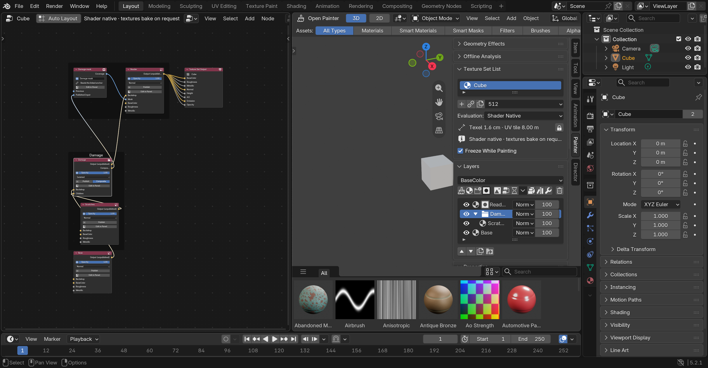

# Open Graph — 0.4.0, node-based editing since 0.8.0

The Layers panel's node icon (*Open Graph*) splits the Painter area and shows the
active texture set as a node graph. The graph is a **projection** of the layer
stack, not a second document: every node is a layer, every socket is an anchor
producer or consumer, and every layer, mask and channel filter is a node, links show the
actual data flow, and edits in it (links, new nodes, deleted nodes) become the
same stack edits the Painter panels make. The stack stays the source of truth
for painting, evaluation, smart materials and undo.

## What you see

- **Layer nodes** (paint/fill) and **folder nodes**, one per layer, labelled with
  the layer name. Folders are drawn as frames containing the folder node and its
  children; a layer that owns masks or filters gets its own frame around them.
- **Mask nodes**, one per mask, chained left to right in stack order: *Previous*
  in, *Coverage* out, the last one into the layer's *Mask* input. The node body
  shows the mask's enable/name, combine operation, invert, strength, levels and
  its main source controls (generator kind and amount, noise scale, scene field
  kind, filter kind, image). Published Input masks take their anchor on *Published
  Input*; generator masks with micro details take *Micro Height* / *Micro Normal*.
  An Anchor Point mask's *Coverage* output is the anchor other layers read.
- **Filter nodes**, one per channel filter, chained into the layer's channel
  input (*BaseColor*, *Roughness*, …) with the filter's controls on the body. An
  Anchor Point filter's output is a channel anchor.
- **Composition links**: every layer's *Output* feeds the *Backdrop* of the layer
  above it, the top child feeds its folder's *Children* input, and the top root
  layer feeds the **Texture Set Output** node — the stack's actual data flow.
- Layer node bodies expose visibility, opacity, blend/folder mode, the *Publish*
  and *Composite* toggles and *Edit in Panel*. Clicking any node selects its layer
  (and mask or filter) in the Painter panels; the list's selection selects the node.

## Editing

- **Search Nodes and Templates** (magnifying glass in the header, also in Shift+A)
  searches layers, procedural fills, masks, mesh selectors, generators, scene fields,
  filters, anchors and templates by name. The header's **Channel** selector chooses
  the channel for new filters and for the fill controls shown on layer nodes.
- **Add** (Shift+A) adds to the active layer: *Mask ▸* painted, fill image, baked
  map, noise, generators, procedurals, scene fields, filter masks, Published Input
  and Anchor Point; *Channel Filter ▸* the filter catalog and an Anchor Point for
  the channel selected in the Painter panel; plus Fill/Paint/Folder layers. New
  nodes are appended to their chain.
- **Mesh Mask** adds Object, Collection, Material, Vertex Group, Face Set, Face
  Selection, UV Island, Normal Direction, Geometry Attribute or Saved Face Region
  coverage. The node exposes the selector and its main controls; saved face regions
  are configured in the Inspector.
- **Mask Group**, **Custom Graph** and **Vector Strokes** have their own node
  types. A Custom Graph starts with a usable Noise → Ramp [Mask Graph](mask-graphs.md);
  **Edit Mask Graph** steps into it in this editor, like entering a node group (Tab returns).
  Vector Strokes gets an
  independent stroke key; author strokes through the Painter tools.
- **Procedural Fill** creates a fill layer with coordinated color, roughness and
  height detail using any source in the procedural catalog. Fill nodes expose the
  selected channel's enable, color/value, image, projection and procedural controls.
- **Group** in the header wraps selected, consecutive sibling layer nodes in a
  passthrough folder. Select the layer nodes, then Group; their IDs and order survive.
- **Anchor links**: drag an anchor output (a layer's *Output* / *Composite*, an
  Anchor Point mask or filter) into a consumer socket — a Published Input mask,
  a micro-detail slot, or a channel's content (its first filter when the channel
  is filtered). Dragging from an unpublished *Output* or *Composite* publishes
  the layer first. Deleting such a link clears the reference.
- **Order links**: drag a mask's *Coverage* into another mask's *Previous* (or the
  layer's *Mask*) to move it there in the chain; the same for filters within one
  channel. Drag a layer's *Output* into another layer's *Backdrop* to place it
  directly under that layer (into its folder if needed), or into a folder's
  *Children* to make it the folder's top child. Composition links cannot be
  deleted: chains have no gaps, and the sync redraws them.
- **Nested mask links**: each group has a *Members* input and its own frame.
  Members chain together before entering their group, whose output joins the outer
  chain. Adding while a group or member is selected appends inside that group.
  Drag coverage into *Members* to move a mask into the group, into *Previous* to
  place it before a sibling, or into the layer's *Mask* to move it to the outer
  chain's end. Moving a group moves its descendants together; self-nesting is refused.
- **Deleting a node** deletes that mask or filter from the stack; painted masks
  and layers are deleted in the Painter panel, and the mirror recreates their node.
  Deleting a mask group dissolves it, preserving its members, including painted data.
- A link that would create a cycle, chain masks across layers, or pair
  incompatible sockets is refused: the stack is unchanged, the status line
  explains why, and the link disappears on the next sync.
- *Auto Layout* (header) re-places every node: rows follow the stack order, a
  layer's mask chain shares its row, filter chains sit under it, columns follow
  dependency rank. Nodes you moved keep their positions across syncs.
  Newly inserted template groups are placed clear of existing nodes; equal-rank
  nested branches use separate rows.

## Templates

Choose **Templates** in the graph header or Shift+A, or search for a template.
Each insertion creates a named folder containing connected, ordinary editable
layers, masks and filters. It inserts inside the selected folder, or alongside
the selected layer. Existing content stays in place. Each insertion has fresh
IDs and independent internal references, can be duplicated with the folder, and
supports Blender undo and save/reopen. No template needs a mesh-map bake.

| Template | Contents |
| --- | --- |
| Rough Plastic | Plastic grain across color, roughness and height, with roughness levels |
| Brushed Metal | Directional brushed metal detail and editable roughness levels |
| Chipped Paint | Metal substrate under a paint coat, procedural coverage and a threshold |
| Layered Grunge | Nested mask group combining broad stains, fine breakup and levels |
| Shared Surface Detail | Published grain mask linked to roughness and height filters |
| Top Surface Dust | Upward-facing mesh coverage combined with particulate breakup |
| Noise → Ramp | Custom Graph mask with a reusable Coordinates → Noise → Ramp Mask Graph |
| Cells → Ramp | Custom Graph mask with a reusable Coordinates → Cells (Worley) → Ramp Mask Graph |
| Layered Noise → Ramp | Custom Graph mask multiplying two noise scales before a Ramp |

The last three create [Mask Graphs](mask-graphs.md), Open Painter's own node trees, as
well as a Painter folder. Use **Edit Mask Graph** on the Custom Graph node to change the
graph. Each inserted template owns its own graph; choosing that graph on another Custom
Graph mask shares it deliberately. The engine renders a Mask Graph as a GPU pass of its
own, and export evaluates it with the same formulas on the CPU.

## How it is evaluated

The Open Graph is Open Painter's own node tree type, never a Blender shader tree, and
editing it changes no material. The stack it projects is evaluated by the
[Open Painter engine](open-painter-engine.md): one small GPU program per layer channel,
content prefix or mask prefix, rendered into the texture set's channel images. A material
reads those images through the single **Open Painter Texture Set** node (Shader Editor ▸
Add ▸ Input), so adding a mask, relinking an anchor or dragging a slider re-renders only
the channels it reaches and never recompiles a material. A Custom Graph mask's Mask Graph
is a GPU pass of its own: a slider in it is a uniform, and a structural edit recompiles that
pass alone. Only masks from earlier files that still point at a Blender shader group are
evaluated by the CPU reference (a Cycles bake).

## How it stays in sync

`graph/mirror.py` computes the expected projection (`project`) and a structural
signature (`signature`: ids, hierarchy, names, visibility, publish flags, anchors,
consumer fields, mask and filter chains — not slider values). The UI lifecycle tick (0.15 s) reconciles
every open graph whose signature changed, editing nodes/sockets/links in place and
keeping `op_id` as the only identity (no RNA reference survives a tick). The tree
is a `bpy.data.node_groups` datablock of type `OpenPainterGraph` with a fake user,
owned by the set id, so undo/redo restores the stack and its mirror together.
`NodeTree.update()` diffs the tree's nodes and links against the projection and
applies the user's edit through `graph/edits.py` (`connect` / `disconnect` for
anchors, `reorder` for chain and backdrop links, `delete` for removed nodes),
validated with `references.issues`.

Tests: `tests/integration/graph_mirror.py`, `graph_link_edits.py`,
`graph_templates.py`, `graph_view_ui.py` and `graph_templates_ui.py` (real windows),
`tests/unit/test_graph_layout.py`.
