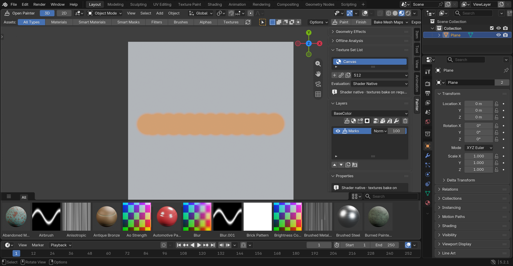

# Vector strokes, Paint Material and the universal canvas — 0.6.0 / 0.6.1 / 0.13.0

The **Vector Brush** keeps a brush gesture as data — a spline of samples with
pressure, radius, tilt and direction, the brush settings and the material values —
and rasterises it on demand. Because a stroke lives in world space on the object,
not in one texture, the same stroke renders on every texture set it touches and at
whatever Output Resolution each set has. Paint at 1K for speed; switch to 8K later
and the strokes re-render crisp.

## Painting (Paint Material, 0.13)

- Select a paint layer: the inspector's **Paint Material** section shows where the
  next stroke goes (`Body > Mud Paint | Color, Roughness, Metallic, Height`), the
  brush (Size in world units or screen pixels resolved at the hit, Opacity, Flow,
  Hardness, Spacing as a fraction of the radius, Alpha image, Paint or Erase), the
  channel toggles and the values of the enabled channels. Press **Paint Material**
  and drag on the assigned surface: the material changes under the pointer, and
  the release records one stroke and one undo step. Esc discards a stroke in
  progress and exits when idle; right-click does the same. A save or another
  shortcut during a gesture commits the partial stroke once and ends it.
- The gesture is resampled at a quarter of the spacing between pointer events and
  every step is re-projected onto the surface, so a fast drag and a slow one leave
  the same marks (`painting/gesture.py`). A miss, a face whose material slot is not
  assigned to the set, a hidden object, another set's surface (unless Paint Across
  Sets is on) or a jump off a silhouette lifts the brush; coming back never bridges
  the gap.
- **Pressure Size** scales the radius with tablet pressure, **Pressure Flow** scales
  each stamp's flow; either, both or neither, never both through one value.
- **Reach** decides which surfaces a stamp may touch. **Surface** (the default)
  paints the surface the pointer hit and what connects to it without turning away
  from the stamp: starting at the face the ray hit (stored with every sample as its
  *anchor*), the stamp walks across shared edges onto neighbouring faces that face
  it and lie inside its box, so a same-facing sheet behind the one under the
  pointer, a neighbouring object, a disconnected piece or the floor of a pocket
  under a lip stays clean whatever the depth limit says; a fold, a rim or a wall
  that turns away stops the walk. The rule reads the geometry snapshot only, so the
  accepted surface is the same after the camera moves, after reopening and at every
  resolution; a stroke whose anchors no longer land on their faces (the mesh was
  edited or renumbered) seeds from the nearest surface within its band instead, on
  one target only. Its known reach: a surface that continues smoothly under
  something else (an open floor running under a shelf) is one surface and is
  painted along; a smoothly ramped tunnel is not blocked. **Depth Band** paints
  every surface within the depth limit of the stamp plane, including hidden and
  separate ones, and is what strokes recorded before this version keep.
- **Depth Limit** (Stroke Details) bounds how far behind or in front of the stamp
  plane a texel may lie, in radii, in either reach. Strokes recorded before 0.13
  keep the old band of one radius; the brush default is half a radius.
- **Paint Across Sets**: off by default (the stroke stays on the selected set and the
  brush lifts at its edge). On, the section lists the sets the stroke may reach; a
  set receives the stroke only when the pointer actually crosses its surface, and
  then a paint layer with the same name is created there and *linked* (same stroke
  key), so the stroke is one record rendered by several sets. The *Vector Strokes*
  box lists "Also on: …". Every stroke records the sets it was permitted to reach
  when it was painted (its *scope*): a later stroke painted without Paint Across
  Sets stays on its own set even where an earlier stroke linked another one, and
  the box lists "Not permitted on: …" for the sets that share the key but may not
  render the stroke. Strokes recorded before the field existed render wherever
  their key is shared, as they always did. Duplicating a layer or a set, and
  applying a saved material, copies the strokes the source could render, scoped
  to the copy.
- The target of a gesture is fixed at pointer-down from the current selection
  (set, layer or Vector Strokes mask) together with the brush values: change the
  selection and the next stroke goes there without leaving the tool; change it,
  hide or delete the target, or edit the assigned geometry, UVs or slots while the
  pointer is down and the gesture is discarded with a reason. The destination
  label follows the selection while idle and names the captured target while
  painting.
- While the pointer is down the enabled channels show the stroke through bounded
  preview images (512² for four channels, 1024² for one or two) bound to the layer's
  inputs of the live material, rasterised with the same kernel and compositing as
  the committed stroke and published together from one revision. On release the
  preview stays until the committed boundary publishes, then goes.
- Every stroke stays editable: the list under the layer selects one; change its
  radius, hardness, flow, projection, mode, alpha or material values, reorder,
  duplicate, delete, or **Rasterize** it into the layer's paint images (image-swap
  undo) when you want pixels. *Purge Orphans* drops strokes no layer renders.
- A mask can render strokes too: mask source **Vector Strokes** with *This Layer's
  Strokes* or a *New Key* painted into with the brush.
- Native pixel painting keeps working on the same layer: strokes composite over the
  painted image.

## How it renders

`painting/stroke_raster.kernel` scores every texel of a set against the samples:
each sample is a disc of its radius in the plane of its normal (or of the view for
planar strokes), with a depth band of one radius, front-facing only, falling off
from hardness outwards, scaled by pressure and flow; samples union with Max or
Flow. The texels come from the set's own world-position and normal rasters
(`geometry/uv_rasterizer.rasterize` over the triangles inside the stroke's
bounds), so seams and sets are invisible to the stroke; a one-texel dilation into
uncovered texels hides seam cracks. Occlusion is the depth band (a stroke on a
thin plate also marks the other side within one radius; the plan's precise
per-sample ray test is a later refinement).

Per-stroke coverage is cached in the set's raster cache by (stroke revision,
resolution, geometry stamp); the raster is computed only over the brush footprint's
UV window of each triangle (plus one texel), which is the same result as the whole
triangle. On the CPU reference the strokes composite under a paint layer's channel
content (`channel_eval._base_source`); in the shader-native preview they are a
raster boundary per channel (`shader_graph._strokes_boundary`) whose identity is the
stroke tuple plus the geometry stamp. Since 0.13 that boundary is incremental: a
published leaf records which strokes it holds and the rows of each, and the next
identity starts from that leaf's pixels and recomputes only the rows of the strokes
that differ (added, edited or undone), with a transparent placeholder and the paint
canvas as the fallback while a layer's first leaf publishes. Resolution changes
rebuild the graph at the new size, undo rehydrates, and a moved or edited mesh
re-projects. Strokes are excluded from smart-material documents (world-space asset
data). Duplicating a layer or a Vector Strokes mask copies its strokes under a new
key, so the copies edit independently.

Tests: `tests/unit/test_stroke_raster.py`, `tests/integration/vector_strokes.py`
(universal canvas, seams, edits, resolution, geometry, undo, reload),
`stroke_parity.py` (CPU vs shader, re-identification, rehydration),
`material_painting.py` (replay: footprint, disabled channel, zero values, event
rates, pressure, live preview parity, incremental leaves, seams, misses and
excluded surfaces, depth limit, multiset scope, erase, cancel, geometry change,
save/reopen, duplicates), `vector_brush_ui.py`, `material_painting_ui.py` (real
window: fast and slow drags, latency, settle, Esc, undo, native route) and
`material_session_ui.py` (500 strokes with undo/redo, saves and target changes).

## Native painting across sets (0.6.1)

Blender's own brush can cross sets too: turn on **Paint Across Sets** in the paint
layer's properties before *Paint*. The session then runs in Blender's material
paint mode: every texture set assigned to the object gets a paint layer linked to
the active layer's key (created where missing), each set's display material gets
an owned *Paint Canvas* image node pointing at that set's layer image, and the
face restriction covers the union of the sets' material slots. One stroke down a
seam writes both canvases; change detection, the shader-native fast path and
Finish evaluate every participating set; Finish removes the canvas nodes and
restores image paint mode. Limits: each set paints the same channel; brush undo
is per image (Blender restores both tiles of one stroke together); seam hairlines
between islands of different sets are per image — the Vector Brush has no such
seam. Tests: `tests/integration/multi_set_paint.py`, `multi_set_paint_ui.py`.
